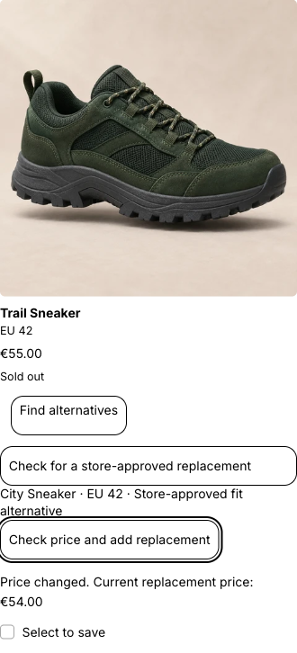

# Confirm an updated wishlist replacement price

A buyer opens a shared RVI guest wishlist and finds that Trail Sneaker EU 42 is sold out. The shop has approved City Sneaker EU 42 as a replacement for this market.

If the City price changes before it reaches the cart, RVI displays the current amount on the wishlist and asks the buyer to confirm it. On confirmation, RVI checks the exact approved variant, its availability and its price again in the buyer's country. If the price changes again, the wishlist displays the new amount and asks again.

*Captured on the published Shopify demo. €54 is a simulated price used to show the confirmation step.*

To explore the wishlist, open the [RVI Shopify listing](https://apps.shopify.com/recently-viewed-products-7?locale=en&utm_source=github&utm_medium=referral&utm_campaign=rvi_relaunch_202611&utm_content=dawn_wishlist_price_review) and choose **View demo store**. On Trail Sneaker, choose **Open example shared wishlist**, then **Check for a store-approved replacement**.
